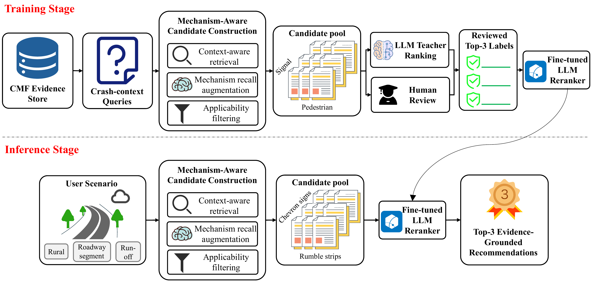

# SafeCMF-LLM

**Evidence-grounded road safety countermeasure recommendation from crash-context queries: A modular LLM framework**

Bingyou Dai, Xuesong Wang, Guangzhuo Tang, Yuxiang Feng, Qiming Guo, Yu Bai

*Accident Analysis & Prevention*

SafeCMF-LLM recommends road safety countermeasures from natural-language crash scenarios. It combines a store of **8,844 CMF Evidence Cards**, mechanism-aware candidate construction, and a fine-tuned LLM that selects up to three traceable evidence IDs.

## Framework

Candidate construction uses context-aware retrieval, mechanism-aware recall augmentation, and engineering applicability filtering. The LLM selects Evidence IDs from the candidate pool; countermeasure descriptions, effect estimates, and sources are retrieved from the evidence store.

## Code

Training, inference, retrieval, and evaluation code is available in [`scripts/`](scripts/). See [Usage](docs/usage.md) for installation and commands.

## Example data

The example dataset contains **100 records sampled from the final training set**:

- 65 complete queries and 35 queries with missing information.
- Each record includes the query, its candidate Evidence Cards, and reference labels.
- Reference outputs contain zero to three ranked recommendations.

[100 examples (JSONL)](data/release/examples100.jsonl) · [Data format and sampling details](data/release/README.md)

The study uses **2,935 queries: 2,635 for training and 300 for testing**.

## Main results

Fine-tuned model results under the same 300-query test protocol and automatically constructed Top-30 candidate pools.

| Model | Exact Top-1 | Exact Hit@3 | Mechanism Hit@3 |
|---|---:|---:|---:|
| Qwen3-14B | 44.35% | 71.13% | 78.24% |
| Llama3.1-8B | 50.63% | 72.80% | 78.66% |
| **Qwen3-32B** | **53.14%** | **76.15%** | **83.26%** |

These three metrics are calculated on the 239 test queries with nonempty reference sets.
